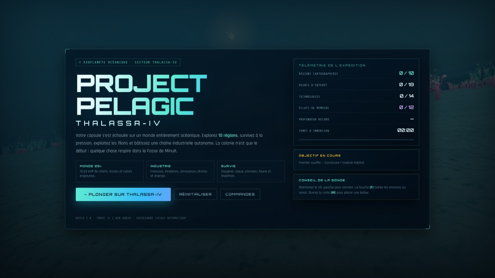
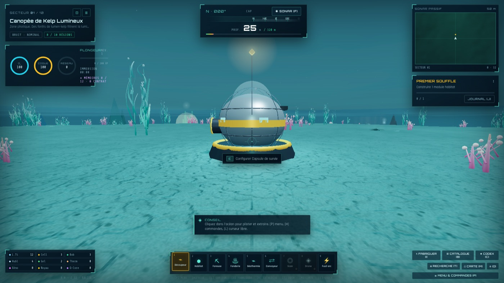
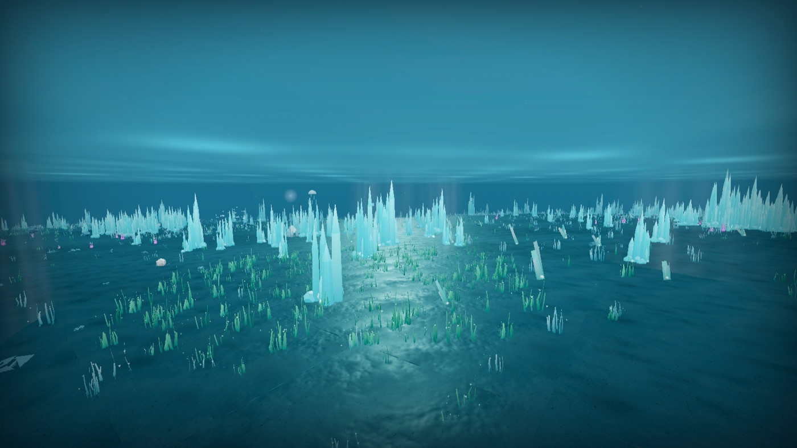
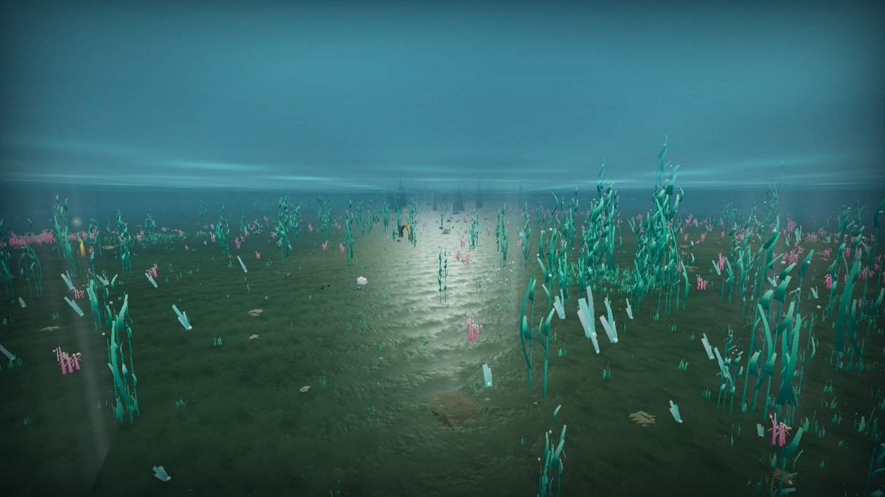
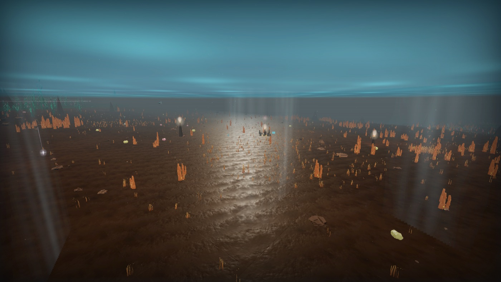
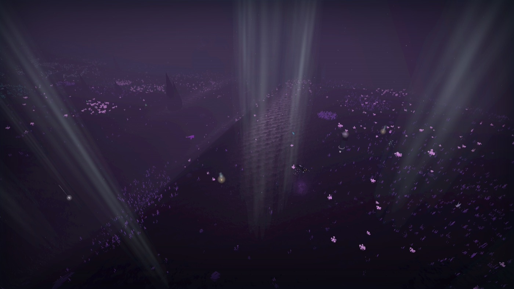
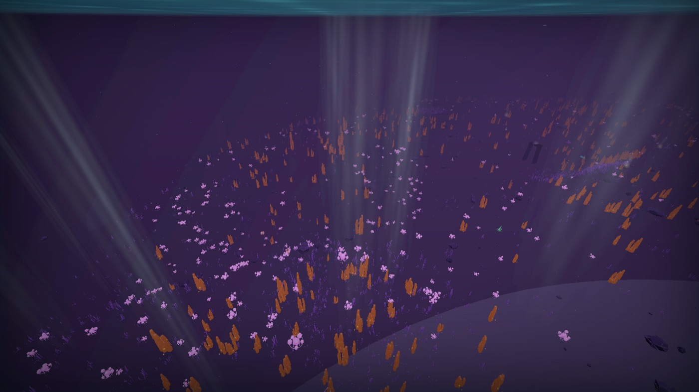

# PROJECT PELAGIC — THALASSA-IV

**Un jeu d'exploration, de survie et de construction sous-marine en 3D, jouable directement dans le navigateur.**

Votre capsule s'est échouée sur Thalassa-IV, une exoplanète entièrement océanique. Explorez des biomes jusqu'à 3 200 m de profondeur, gérez votre oxygène et la pression, exploitez les gisements, bâtissez une colonie industrielle autonome — et découvrez ce qui respire dans la Fosse de Minuit.



## Sommaire

- [Jouer](#jouer)
- [Contenu du jeu](#contenu-du-jeu)
- [Contrôles](#contrôles)
- [Systèmes de jeu](#systèmes-de-jeu)
- [Architecture du projet](#architecture-du-projet)
- [Sauvegarde](#sauvegarde)
- [Compatibilité et performances](#compatibilité-et-performances)
- [Publier sur GitHub Pages](#publier-sur-github-pages)
- [Crédits](#crédits)

## Jouer

Le jeu n'a **aucune dépendance à installer** et **aucune étape de build**. Il suffit de servir le dossier avec un serveur HTTP statique.

```bash
# Depuis la racine du projet
python3 -m http.server 8080
```

Ouvrez ensuite [http://localhost:8080](http://localhost:8080) dans un navigateur récent.

> Un serveur HTTP est recommandé plutôt qu'une ouverture directe en `file://` : le jeu utilise le stockage local, le pointer lock et le contexte audio, qui sont plus fiables sur une origine HTTP.

### Prérequis

- Navigateur de bureau récent avec **WebGL 2** : Chrome, Edge, Firefox ou Safari.
- Clavier et souris. Il n'existe pas encore de contrôles tactiles dédiés.
- Une carte graphique discrète ou intégrée récente pour le preset **Ultra**. Les presets **Low** et **Medium** restent jouables sur du matériel modeste.

## Contenu du jeu

| Monde | Progression | Industrie | Rejouabilité |
|---|---|---|---|
| 6,4 km × 6,4 km (40,96 km²) | 14 technologies | 9 modules de base | 12 éclats de mémoire |
| 10 régions + Faille périphérique | 13 succès | Améliorations Mk.I → Mk.III | 13 contrats renouvelables |
| 18 points d'intérêt | 57 entrées de codex | Réseau électrique, foreuses, fonderies | Marché achat / vente |
| Profondeur maximale 3 200 m | 3 noyaux xéno pour la balise orbitale | Drones cargo et convoyeurs | 4 filtres de mode photo |

### Galerie

| Canopée de Kelp | Plateau Cristallin |
|---|---|
|  |  |

| Métropole Engloutie | Fumeurs Volcaniques |
|---|---|
|  |  |

| Fosse de Minuit | Faille Périphérique |
|---|---|
|  |  |

## Contrôles

### Déplacement et survie

| Action | Touche |
|---|---|
| Nager | `ZQSD` / `WASD` |
| Monter / descendre | `Espace` / `Maj` |
| Regarder | Clic dans l'océan |
| Libérer / reprendre le curseur | `L` |
| Menu et commandes | `P` |
| **Console universelle (sans libérer le curseur)** | **`Tab`** |
| Sonar actif | `F` |
| Aide | `H` |
| Fermer un panneau | `Échap` / `Tab` / bouton `✕` |
| Surcharge énergétique | `F6` |
| Silence (discrétion) | `F7` |
| Remontée d'urgence | `F3` |
| Balayage automatique | `F10` |
| Oxygène d'urgence | `U` |
| Réparation de coque | `K` |
| Blocage de profondeur | `V` |
| Signal de rappel | `F8` |

### Industrie et interface

| Action | Touche |
|---|---|
| Extraire / interagir | Clic gauche |
| Configurer un module | `E` |
| Fabricateur de poche | `I` |
| Catalogue de construction | `B` |
| Recherche technologique | `T` |
| Carte tactique | `M` |
| Journal et contrats | `J` |
| Codex | `C` |
| Pivoter un module | `R` |
| Démanteler un module | `X` |
| Reconstruire le dernier module | `Y` |
| Gisements / nœuds | `N` |
| Scan de faune | `F4` |
| Mode photo | `F2` |
| Filtre photo | `F3` en mode photo |
| Sauvegarder / charger | `F5` / `F9` |

La **console de commandement** (`Tab`) regroupe en un seul endroit la carte, l'inventaire, la recherche, le journal, le codex, le catalogue, les paramètres, l'aide et les protocoles de terrain. Elle s'ouvre et se ferme au clavier, sans avoir à presser `Échap` ni à libérer le curseur.

## Systèmes de jeu

### Exploration

- **Monde procédural continu** de 40,96 km², avec reliefs, fosses, cheminées hydrothermales, ruines et épaves.
- **10 régions distinctes** — canopée photique, plateau cristallin, banquise fossile, métropole engloutie, fumeurs volcaniques, aiguilles hydrothermales, cimetière abyssal, labyrinthe d'obsidienne, Fosse de Minuit et Gueule xéno — plus la **Faille périphérique**.
- **18 points d'intérêt** uniques : épaves, temples, monolithes, ossuaires, arches de verre, caldeira, etc.
- **12 éclats de mémoire** cachés dans les régions. Chaque relique accorde un **bonus permanent** (vitesse, oxygène, coque, énergie, scan, forage, raffinage, discrétion, projecteur) et une archive narrative.
- **Efflorescence bioluminescente** : un secret photographique de la canopée de Kelp, à capturer en mode photo. Il accorde une archive de codex et un souffle d'oxygène.
- **Carte tactique** avec brouillard de guerre, balises personnalisées, points d'intérêt découverts et voyage rapide.
- **Cartographie automatique** des régions au fil de l'exploration.
- **Mode photo** avec masquage du HUD et quatre rendus colorimétriques.

### Survie

- Oxygène consommé hors des habitats, recharge dans les modules pressurisés.
- Coque soumise aux collisions, aux créatures et à la **pression** : au-delà de la profondeur de coque, les fissures s'accumulent.
- **10 espèces** de faune, des bancs inoffensifs au Tisserand abyssal, en passant par les prédateurs qui chassent au sonar.
- Outils de secours : oxygène d'urgence, réparation de coque, remontée d'urgence, blocage de profondeur et signal de rappel. Un rapatriement automatique après rupture sauve la progression mais coûte **25 % du fret brut** : il ne remplace pas une remontée préparée.
- Protocoles tactiques : **surcharge** de production, **silence** pour réduire la détection, **balayage automatique** des environs.

### Colonie et industrie

- **9 modules** : habitat, foreuse, fonderie, prise géothermique, salle de scan, baie de drones, jardin de biofibres, entrepôt et réacteur xéno.
- **Améliorations Mk.I → Mk.III** pour chaque module, avec coûts, débit, stockage et rendement croissants.
- **Réseau électrique** à équilibrer : production géothermique, réacteur xéno, consommation des modules.
- **Foreuses** ancrées sur les gisements, **fonderies** à recette configurable, **convoyeurs** et **drones cargo** autonomes.
- **14 technologies** déblocables et **18 recettes** de raffinage ou de fabrication de composants.
- **13 contrats de colonie renouvelables** avec récompenses, expérience et suivi de progression.
- **Marché** achat / vente avec valeurs dynamiques par ressource.
- **Balise orbitale** : stabiliser trois noyaux xéno pour achever l'expédition.

### Confort et interface

- Console de commandement accessible avec `Tab`, avec recherche instantanée des actions.
- Inventaire filtrable, fiches d'usage détaillées, **fabrication par lot ×5**.
- Journal, contrats, records et objectifs regroupés, avec un bouton **SUIVRE L'OBJECTIF** qui place directement la balise de navigation sur la prochaine étape cartographique.
- **Tableau de bord de la colonie** dans le journal : production et consommation électrique, efficacité, modules, drones, convoyeurs et alertes de réseau.
- **Sauvegarde automatique** toutes les 45 secondes, sauvegarde manuelle, export et import de fichier, avec **sauvegarde de secours** restaurée automatiquement si la principale est illisible.
- Paramètres de qualité graphique, sensibilité, FOV, inversion d'axe, mini-carte, scanlines et échelle du HUD.
- Notifications contextuelles et aides à l'action dans le HUD.

## Architecture du projet

```text
.
├── index.html              # Structure, design system CSS, HUD et panneaux
├── js/
│   ├── data.js             # Monde, ressources, recettes, bâtiments, techs, faune, codex
│   ├── audio.js            # Moteur audio procédural (Web Audio)
│   ├── world.js            # Génération du monde, biomes, flore, faune, POI
│   ├── factory.js          # Colonie, énergie, production, convoyeurs, drones, upgrades
│   ├── ui.js               # HUD, carte, inventaire, console, sauvegardes, événements
│   ├── game.js             # Boucle de jeu, joueur, survie, économie, progression
│   └── vendor/             # Three.js r128 et passes de post-traitement (embarqués)
├── docs/screenshots/       # Captures utilisées par ce README
└── README.md
```

Le projet est volontairement **sans framework et sans bundler** : les scripts sont chargés dans l'ordre par `index.html`, et Three.js est embarqué dans `js/vendor` pour que le jeu démarre sans CDN. Les polices sont chargées depuis Google Fonts, avec repli sur les polices système si le réseau est indisponible.

## Sauvegarde

Les parties sont stockées dans le **`localStorage`** du navigateur sous la clé `pelagic_thalassa_save_v4`, avec une copie de secours dans `pelagic_thalassa_save_v4_backup`.

- Sauvegarde automatique toutes les 45 secondes.
- Sauvegarde manuelle avec `F5` ou depuis le menu.
- Export / import JSON depuis le menu pause, pour transférer une partie ou archiver une sauvegarde. L'import vérifie le format et conserve la partie précédente en secours.
- Les sauvegardes sont liées à l'origine du site : jouer sur `localhost` et sur GitHub Pages crée deux stockages séparés.
- « Réinitialiser » dans le menu principal efface la sauvegarde locale après confirmation.

## Compatibilité et performances

- Rendu **Three.js** avec éclairage, brouillard volumétrique simulé, particules, ombres et **bloom**.
- Instanciation des éléments répétés (flore, faune, débris) pour limiter les appels de rendu.
- Quatre presets graphiques : **Low**, **Medium**, **High** et **Ultra**, réglables dans les paramètres.
- La qualité par défaut est **High**. Sur une machine modeste, passer en **Medium** réduit le pixel ratio, la densité de flore et la distance de vue.
- Le jeu est pensé pour le bureau : le pointer lock, le clavier et la souris sont nécessaires.

## Publier sur GitHub Pages

1. Créez un dépôt GitHub et poussez le contenu de ce dossier à la racine du dépôt.
2. Dans **Settings → Pages**, choisissez **Deploy from a branch**.
3. Sélectionnez la branche `main` et le dossier `/ (root)`.
4. Ouvrez l'URL fournie par GitHub Pages.

Aucun workflow ni build n'est nécessaire : `index.html` est le point d'entrée.

```bash
git init
git add .
git commit -m "Project Pelagic — Thalassa IV"
git branch -M main
git remote add origin https://github.com/<votre-compte>/<votre-depot>.git
git push -u origin main
```

Le fichier `.gitignore` exclut les captures QA brutes, les fichiers système et les archives locales. Les images utilisées par ce README sont dans `docs/screenshots/` et sont donc versionnées.

## Crédits

- **Three.js r128** et les passes `EffectComposer`, `RenderPass`, `ShaderPass`, `UnrealBloomPass` : Three.js Authors, licence MIT.
- **Polices Orbitron, Rajdhani et Share Tech Mono** : SIL Open Font License, servies par Google Fonts.
- **Direction artistique, code, level design, interface et audio procédural** : projet original Project Pelagic — Thalassa-IV.
- Toutes les textures, animations, créatures et ambiances sonores sont générées par le jeu ; aucun asset externe payant n'est requis.
